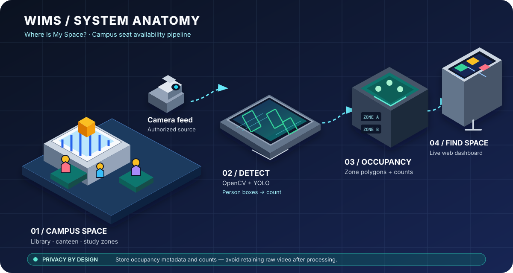

# Where Is My Space? (WIMS)

> **Find your space before you reach there.**  
> Intelligence for physical spaces.

WIMS is a campus spatial-intelligence project that estimates how spaces are being used and helps people find suitable study areas before walking there.

## How WIMS works



WIMS turns an authorized camera source into useful occupancy information: the detector identifies people, zone logic estimates space usage, and the dashboard presents counts to help students choose a study area. The system is designed to keep the focus on occupancy metadata rather than retaining raw video.


## Live Application

**Frontend:** https://where-is-my-space-wims.vercel.app

The web app includes a mobile-first **WIMS Capture** route at `/capture`. Users can open the deployed link on a phone without installing Python, OpenCV, or YOLO.

## Features

- Live occupancy dashboard
- Mobile-first video capture interface
- Phone camera recording
- Screen-share recording where supported
- MP4 and WebM video upload
- Authorized RTSP/IP camera registration
- Occupancy zones with polygon support
- AI person detection using OpenCV and YOLO
- Annotated preview frames with bounding boxes
- Durable background processing jobs
- Private temporary video storage
- Automatic raw-video cleanup after processing
- Supabase-backed metadata and occupancy snapshots
- Installable PWA support

## Architecture

```text
Phone / Laptop Browser
        |
        v
Next.js Frontend on Vercel
        |
        v
FastAPI Upload API
        |
        +----------------------+
        |                      |
        v                      v
Supabase Metadata       Private Video Storage
        |
        v
AI Worker
(OpenCV + YOLO)
        |
        v
Occupancy Snapshots
        |
        v
Live Dashboard
```

## Project Structure

```text
.
├── backend/
│   ├── app/
│   │   ├── detector.py
│   │   ├── main.py
│   │   ├── occupancy.py
│   │   ├── ratelimit.py
│   │   └── worker.py
│   ├── tests/
│   ├── Dockerfile
│   ├── requirements.txt
│   └── .env.example
├── web/
│   ├── src/
│   ├── public/
│   ├── package.json
│   └── .env.example
├── supabase/
│   └── migrations/
├── docs/
├── IMPLEMENTATION_PLAN.md
└── WIMS_SETUP_REPORT.md
```

## Frontend

The frontend is built with:

- Next.js
- React
- TypeScript
- Tailwind CSS
- Supabase JavaScript client

### Frontend Routes

| Route | Description |
|---|---|
| `/` | Occupancy dashboard |
| `/capture` | Mobile capture and upload studio |
| `/manifest.webmanifest` | PWA manifest |

### Run Frontend Locally

```bash
cd web
npm install
cp .env.example .env.local
npm run dev
```

Open:

```text
http://localhost:3000
```

Set the API URL in `web/.env.local`:

```env
NEXT_PUBLIC_WIMS_API_URL=http://localhost:8000
```

### Frontend Checks

```bash
npm run typecheck
npm run lint
npm run build
```

## Windows PowerShell: full local demo setup (no Render card required)

Use this section on Windows 10/11 with PowerShell or Windows Terminal. Keep the API and worker running on the same computer during the demo.

### 1. Clone the repository

Open PowerShell in a folder where you keep projects:

```powershell
git clone https://github.com/MayanKiz/Where_Is_My_Space.git
cd Where_Is_My_Space
cd backend
```

If the repository already exists, do not clone it again. Enter its backend directory instead:

```powershell
cd C:\Users\YOUR_WINDOWS_USER\Where_Is_My_Space\backend
```

Replace `YOUR_WINDOWS_USER` with your Windows account folder name. You can confirm the current folder by running `Get-Location`.

### 2. Confirm the files exist before installing

Run:

```powershell
Get-Location
Get-ChildItem
Test-Path .\requirements.txt
```

The last command should print `True`. The backend folder must contain `requirements.txt`, `app`, `tests`, and `.env.example`. If it prints `False`, you are in the wrong folder or the checkout is incomplete. From the repository root, run `cd backend` and check again. Do not run `pip install -r requirements.txt` until the file exists.

### 3. Create and activate the virtual environment

Project Docker uses Python 3.12. Prefer Python 3.12 locally for the closest match. Check:

```powershell
py -0p
python --version
```

If Python 3.12 is installed, run:

```powershell
py -3.12 -m venv .venv
.\.venv\Scripts\Activate.ps1
python --version
```

If PowerShell blocks activation, use this temporary per-terminal setting and try again:

```powershell
Set-ExecutionPolicy -Scope Process -ExecutionPolicy Bypass
.\.venv\Scripts\Activate.ps1
```

This setting applies only to the current PowerShell process. Alternatively, activate through Command Prompt with `.venv\Scripts\activate.bat`.

The prompt should begin with `(.venv)`. Your screenshot showed Python 3.13.15; if a package installation fails under Python 3.13, use Python 3.12 rather than repeatedly reinstalling packages into the same environment. To recreate the environment with Python 3.12, deactivate it, remove only the generated `.venv` folder, and rerun the commands above.

### 4. Install backend dependencies

Still inside `backend`, first verify the file:

```powershell
Test-Path .\requirements.txt
```

Then install:

```powershell
python -m pip install --upgrade pip
python -m pip install -r .\requirements.txt
```

If you see `No such file or directory: requirements.txt`, stop and use `Get-Location` plus `Get-ChildItem` to correct the path. Do not create an empty replacement requirements file.

### 5. Create local environment settings

```powershell
Copy-Item .env.example .env
notepad .env
```

Fill in the values from your own Supabase project dashboard. The backend needs:
- `SUPABASE_URL`: Project URL.
- `SUPABASE_SERVICE_ROLE_KEY`: backend-only secret key for server operations. Use the server-side secret key shown for your Supabase project; never put it in frontend variables or commit it to Git.
- `WIMS_CAPTURE_ACCESS_CODE`: generate a strong random pairing code by running `python -c "import secrets; print(secrets.token_urlsafe(24))"`.
- `WIMS_SOURCE_ENCRYPTION_KEY`: generate once by running `python -c "from cryptography.fernet import Fernet; print(Fernet.generate_key().decode())"`.

Keep the remaining bucket and worker defaults from `.env.example`. For local browser testing, set `CORS_ORIGINS=http://localhost:3000`. Do not paste any secret values into chats, screenshots, issue reports, or GitHub. Never commit `.env`.

### 6. Apply and verify Supabase migrations

In the Supabase dashboard, open the project intended for WIMS and check that it is active. If it is paused/inactive, restore it from the dashboard first. In SQL Editor, run the migration files in this exact order, one at a time:

1. `supabase/migrations/20261010150000_initial_wims_schema.sql`
2. `supabase/migrations/20261010160000_wims_capture_sources.sql`
3. `supabase/migrations/20261017120000_wims_ai_worker.sql`

For each file, open the file from this repository on GitHub, click **Raw**, copy the complete SQL, paste it into Supabase SQL Editor, and run it. Wait for success before running the next migration. If one fails, stop and save the exact error text; do not repeatedly run later migrations or delete/reset tables.

After success, verify in Table Editor that `locations`, `zones`, `processing_jobs`, `occupancy_snapshots`, and `video_sources` exist. In Storage, verify the private `wims-temporary-videos` and `wims-job-previews` buckets. Do not manually add demo occupancy rows until the API and worker are working.

### 7. Run backend checks

From the backend folder, with `(.venv)` active:

```powershell
python -m compileall -q app
python -m pip install pytest
python -m pytest tests -q
```

The compile command should return to the prompt without an error. Tests should report passed tests or a clear failure summary.

### 8. Start the API and AI worker in separate terminals

In **Terminal 1**, go to `backend`, activate the virtual environment, and start the API:

```powershell
cd C:\Users\YOUR_WINDOWS_USER\Where_Is_My_Space\backend
.\.venv\Scripts\Activate.ps1
uvicorn app.main:app --host 127.0.0.1 --port 8000
```

Open `http://127.0.0.1:8000/health` in the browser. OpenAPI docs, if enabled, are at `http://127.0.0.1:8000/docs`.

In **Terminal 2**, use the same backend folder and environment, then run:

```powershell
cd C:\Users\YOUR_WINDOWS_USER\Where_Is_My_Space\backend
.\.venv\Scripts\Activate.ps1
python -m app.worker --mode all
```

The worker downloads/verifies its model as needed; the first startup can take time and requires an internet connection. Keep both terminals open. Closing either terminal stops that process.

### 9. Connect the Vercel frontend

A deployed Vercel website cannot reach your laptop's `127.0.0.1` address. For a local-only test, run the frontend on the same laptop and set its `web/.env.local` value to `NEXT_PUBLIC_WIMS_API_URL=http://localhost:8000`. Restart the frontend after changing environment variables.

For a demo from other devices or the public Vercel website, you need a public HTTPS tunnel or a hosted API. Do not expose port 8000 directly to the internet and do not use an unauthenticated public tunnel with private endpoints. Configure the tunnel only after the local API health check passes; the pairing code remains required for capture/upload routes.

### 10. Troubleshooting

- **`requirements.txt` not found:** Run `Get-Location` and `Get-ChildItem`; change into the repository's `backend` folder.
- **`python`/venv points to Python 3.13:** Use `py -3.12 -m venv .venv` with Python 3.12 installed.
- **Supabase connection timeout:** Check the project status in the dashboard, restore it if paused, verify the project URL, network, and credentials. Do not share secret values.
- **SQL/migration error:** Copy the exact error text and note which migration failed. Stop before running the next migration; don't reset the database as a troubleshooting shortcut.
- **401 on capture routes:** Send the configured pairing code in the app; the API expects `X-WIMS-Capture-Key`.
- **503 Supabase not configured:** Confirm `SUPABASE_URL` and `SUPABASE_SERVICE_ROLE_KEY` are present in the backend `.env`, then restart both processes.
- **No occupancy result:** Inspect the worker terminal, job status, storage buckets, and model download output. An upload alone does not prove AI processing completed.

## Backend API

The backend is built with:

- FastAPI
- Python
- Supabase
- OpenCV
- YOLO ONNX
- Pydantic Settings

### Main API Endpoints

| Endpoint | Description |
|---|---|
| `GET /health` | Service and configuration health |
| `GET /v1/sources` | List registered sources |
| `POST /v1/sources` | Register a capture or RTSP source |
| `POST /v1/jobs/upload` | Upload a video and create a processing job |
| `GET /v1/jobs/{job_id}` | Get processing status |
| `GET /v1/jobs/{job_id}/preview` | Get annotated AI preview |
| `GET /v1/zones` | List occupancy zones |
| `POST /v1/zones` | Create a zone |
| `GET /v1/occupancy` | Get the latest public occupancy data |

Capture, upload, job-status, and preview requests require the configured beta pairing header:

```text
X-WIMS-Capture-Key
```

### Run Backend Locally

```bash
cd backend
python -m venv .venv
source .venv/bin/activate
pip install -r requirements.txt
cp .env.example .env
```

Start the API:

```bash
uvicorn app.main:app --reload --port 8000
```

Start the AI worker separately:

```bash
python -m app.worker --mode all
```

Available worker modes:

```bash
python -m app.worker --mode jobs
python -m app.worker --mode stream
python -m app.worker --mode all
python -m app.worker --mode jobs --once
```

### Backend Tests

```bash
python -m compileall -q app
python -m pytest tests -q
```

## Environment Variables

### Frontend

```env
NEXT_PUBLIC_WIMS_API_URL=https://your-api-domain.example
NEXT_PUBLIC_SUPABASE_URL=
NEXT_PUBLIC_SUPABASE_ANON_KEY=
```

Never put backend secrets in frontend variables.

### Backend

```env
SUPABASE_URL=
SUPABASE_SERVICE_ROLE_KEY=

SUPABASE_VIDEO_BUCKET=wims-temporary-videos
SUPABASE_PREVIEW_BUCKET=wims-job-previews

CORS_ORIGINS=https://where-is-my-space-wims.vercel.app

MAX_UPLOAD_MIB=100
UPLOAD_TTL_MINUTES=30
TEMP_UPLOAD_DIR=/tmp/wims-upload-staging

RATE_LIMIT_PER_MINUTE=120
UPLOAD_RATE_LIMIT_PER_MINUTE=10

WIMS_CAPTURE_ACCESS_CODE=
WIMS_SOURCE_ENCRYPTION_KEY=

YOLO_MODEL_PATH=models/yolov5s.onnx
YOLO_MODEL_URL=https://github.com/ultralytics/yolov5/releases/download/v7.0/yolov5s.onnx
DETECTION_CONFIDENCE=0.35
DETECTION_IOU=0.45
FRAME_STRIDE=5
MAX_SAMPLED_FRAMES=60
POLL_SECONDS=5
STALE_CLAIM_MINUTES=30
KEEP_RAW_VIDEO=false
STREAM_INTERVAL_SECONDS=10
```

Never expose these values:

- `SUPABASE_SERVICE_ROLE_KEY`
- `WIMS_CAPTURE_ACCESS_CODE`
- `WIMS_SOURCE_ENCRYPTION_KEY`

## Supabase Setup

Apply the following migrations in order:

```text
supabase/migrations/20261010150000_initial_wims_schema.sql
supabase/migrations/20261010160000_wims_capture_sources.sql
supabase/migrations/20261017120000_wims_ai_worker.sql
```

The migrations create:

- Locations
- Occupancy zones
- Processing jobs
- Occupancy snapshots
- Video source registry
- Worker job-claiming fields
- Private temporary video bucket
- Private AI preview bucket
- Row-level security policies
- Required indexes and constraints

### Supabase Security

- Raw videos are stored in private storage.
- RTSP URLs are encrypted before being stored.
- Browser clients cannot access service-managed jobs.
- Browser clients cannot access saved RTSP URLs.
- Raw videos are deleted after verified processing.
- Only derived occupancy metadata is retained.

## AI Worker

The AI worker:

1. Claims queued jobs atomically.
2. Recovers stale jobs from crashed workers.
3. Downloads and verifies the pinned YOLO model.
4. Samples video frames using OpenCV.
5. Detects people.
6. Applies optional occupancy-zone polygons.
7. Calculates peak occupancy.
8. Uploads an annotated preview to private storage.
9. Saves occupancy snapshots.
10. Deletes the raw video after successful processing.

A job is marked `completed` only after processing results have been persisted successfully.

## Fast local webcam demo (Windows)

This demo runs locally on your laptop and does not require Supabase, a deployed API, or a Render account. It reuses the existing OpenCV + YOLO detector and keeps desktop OpenCV separate from the headless server dependencies.

1. Download/clone the repository and open PowerShell in `Where_Is_My_Space\backend`.
2. Start the demo with one command:

   ```powershell
   .\run_live_demo.bat
   ```

   First run creates an isolated `.venv-live`, installs the small desktop-camera dependency set, and downloads the pinned YOLO model. These steps take longer only the first time. Later runs reuse the environment and model.

3. In the camera window, press **P**, left-click at least three corners around the seating area, then press **P** again to finish the polygon. Right-click removes the last corner while editing; **C** clears the zone; **Q** exits.
4. Set the seat capacity when starting the demo, for example:

   ```powershell
   .\run_live_demo.bat --capacity 42
   ```

If the laptop webcam does not open, close apps that may be using it or try `.\run_live_demo.bat --camera 1`. Allow camera access in Windows privacy settings. The first YOLO model download requires internet access.

**Interpretation:** the total count is the number of people detected in the camera frame. The zone count is people whose lower bounding-box centre falls inside your drawn polygon. “Estimated seats remaining” is capacity minus that zone count, clamped at zero; it is an occupancy estimate, not direct detection of individual chairs. This local demo does not upload or save camera frames.

## Deployment Status

### Frontend

- Platform: Vercel
- Project: `where-is-my-space-wims`
- Repository: `MayanKiz/Where_Is_My_Space`
- Root directory: `web/`
- Status: Deployed

### Backend and Worker

The FastAPI backend and AI worker must run on a persistent service that supports:

- Docker or Python
- Long-running processes
- Environment secrets
- Health checks
- Automatic restarts
- Persistent worker execution

The backend and worker are not deployed until a suitable persistent host and production secrets are configured.

## Production Setup Checklist

- [x] Repository implementation audited
- [x] Frontend TypeScript checks passed
- [x] Frontend lint passed
- [x] Frontend production build passed
- [x] Backend compilation passed
- [x] Backend unit tests passed
- [x] Supabase project verified
- [x] All three Supabase migrations applied
- [x] RLS and private storage verified
- [x] Correct Vercel project created
- [x] Frontend deployed to Vercel
- [ ] Backend API deployed
- [ ] AI worker deployed
- [ ] Production environment variables configured
- [ ] End-to-end upload and AI processing tested
- [ ] Live RTSP camera tested
- [ ] Production-grade authentication added

## Privacy and Safety

Use only camera footage that you are authorized to capture.

WIMS does not use face recognition. The system stores occupancy metadata instead of biometric identities. Raw video should be temporary and deleted after processing.

Do not commit:

- `.env` files
- Service-role keys
- API tokens
- Capture pairing codes
- Encryption keys
- Private camera URLs

## Documentation

Additional documentation is available in the [`docs/`](docs/) directory.

The complete setup audit is available in [`WIMS_SETUP_REPORT.md`](WIMS_SETUP_REPORT.md).

## License

See [`LICENSE`](LICENSE).